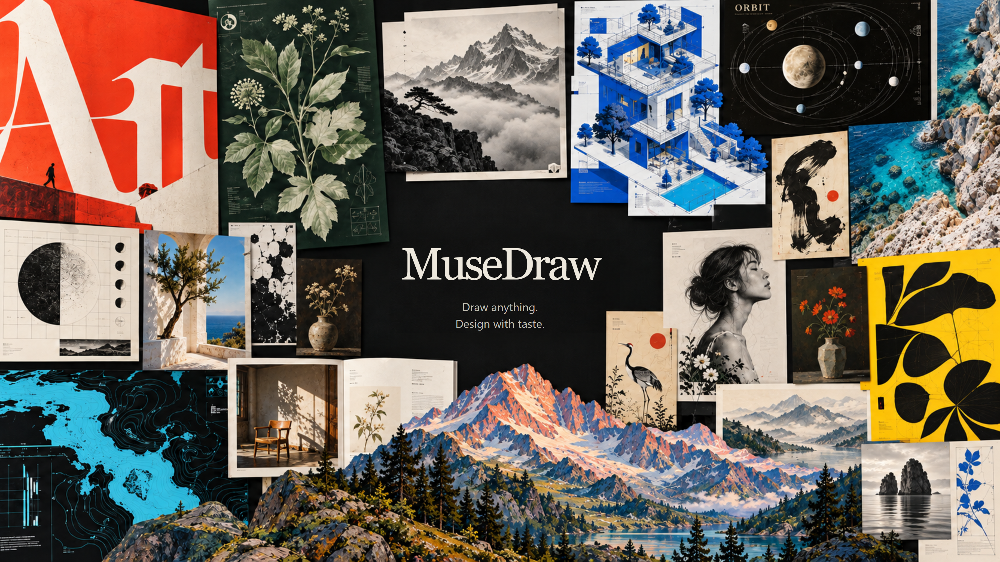

<div align="center">

<a href="https://kanjieteam.github.io/MuseDraw/">
  
</a>

<p>Help everyone give their ideas a better form.</p>

<p>
  <a href="https://kanjieteam.github.io/MuseDraw/">Explore the work ↗</a> ·
  <a href="#start-creating">Start creating</a> ·
  <a href="docs/usage.md">User guide</a> ·
  <a href="README.md">中文</a>
</p>

</div>

MuseDraw is an open-source visual creation project that brings design methods and drawing tools to the AI agent you already use. Describe an idea in your own words, share some material or a reference image, then keep shaping the work through conversation.

## Find the right form for your idea

You bring what you want to express. MuseDraw helps work out how to present it: what to notice first, what belongs together, where to add emphasis, and where to leave space.

- **Start with your content.** A few sentences, a document, or a reference image can be the starting point. Explain the purpose and what you want to preserve.
- **Let the content guide the design.** We focus on how composition, typography, color, and detail work together, giving each piece a clear hierarchy and a character of its own.
- **Keep revising through conversation.** Add a step, shift the emphasis, or develop a direction you like.
- **Use the work and keep the freedom to change it.** Diagrams retain source files, images retain prompts and useful assets, and web work retains HTML/CSS/JavaScript for sharing, using, and refining.

[](https://kanjieteam.github.io/MuseDraw/)

[Explore the work and source files](https://kanjieteam.github.io/MuseDraw/) · [See how it works today](docs/usage.md)

## Start creating

Install in a Skill-capable AI agent that can read and write files and run commands:

```bash
npx skills add KanJieTeam/MuseDraw
```

Then describe what you need. For example:

```text
Use MuseDraw to explain this publishing workflow to a new teammate:
draft → editorial review → publish.
If the review fails, send it back to the draft for revision.
Make the main path stand out.
```

You can say who the work is for, where it will be used, and share references you like. There is no need to specify coordinates or color codes, or choose a template first.

First use requires Node.js 22+, Playwright, and a compatible browser. Existing installations can be reused; see the [setup and fast-start guide](docs/fast-start.zh-CN.md). If Git downloads are slow, use the [lightweight Skill ZIP](https://kanjieteam.github.io/MuseDraw/downloads/musedraw-skill.zip).

## Keep shaping it

After seeing the first version, continue the conversation:

```text
Make the return path for revisions clearer. Keep everything else unchanged.
```

```text
Use a quieter palette and keep the emphasis on the main flow.
```

MuseDraw chooses a medium that fits the task: structured work usually keeps a scene source with SVG/PNG; painting, photography, and textured imagery use PNG/JPEG or another requested image format; frontend and work interfaces use HTML/CSS/JavaScript. To continue editing, tell your agent what you want to change.

[Read about editing and delivery](docs/usage.md)

## Make good design more accessible

We want everyone to be able to explain things clearly, express a feeling, and share an idea. MuseDraw's long-term goal is to make professional design judgment and production skills available to anyone creating visual work.

That means studying different visual languages, applying useful lessons to real work, and testing them with new briefs and repeated revisions. We care about accuracy, fit with the intent, distinctiveness, and how easily the work can be used and developed further.

You can start from a short brief, source material, or a reference image to make diagrams, posters, brand visuals, scientific figures, images, and frontend pages. Image generation depends on the agent and host tools available; MuseDraw keeps the prompt, source, or code needed for further work.

## Help make the work better

Bring a real brief, a piece of work, or a suggestion. Share what you create, point out what falls short, or contribute design experience and feedback from using MuseDraw.

[User guide](docs/usage.md) · [Contribute](CONTRIBUTING.md) · [Feedback and ideas](https://github.com/KanJieTeam/MuseDraw/issues)

[Apache-2.0](LICENSE) · [Third-party notices](NOTICE)
