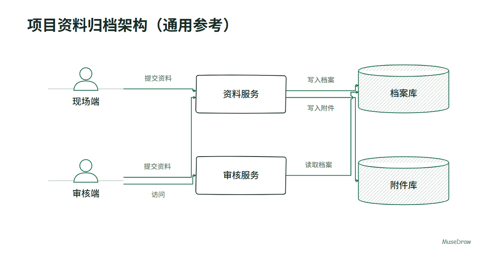
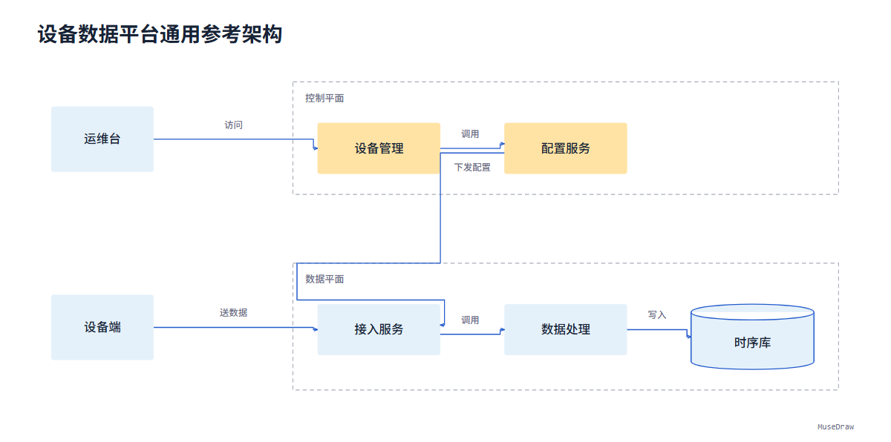

<div align="center">

<picture>
  <source media="(prefers-color-scheme: dark)" srcset="assets/brand/wordmark-dark.svg">
  
</picture>

<h3>专业绘图助手</h3>

<p>把专业配图的设计方法，带进你的 AI 工作流。</p>

<p>
  <a href="https://github.com/KanJieTeam/MuseDraw/actions/workflows/check.yml"></a>
  <a href="LICENSE"></a>
</p>

<p>
  <a href="#快速开始">快速开始</a> ·
  <a href="https://kanjieteam.github.io/MuseDraw/">风格与示例</a> ·
  <a href="docs/usage.zh-CN.md">使用指南</a> ·
  <a href="#参与共建">参与共建</a> ·
  <a href="README.en.md">English</a>
</p>

</div>

---

MuseDraw 是一个开源专业绘图 Skill。你提供几句话和系统资料，智能体理解内容，MuseDraw 的绘图代码完成排版、图形、连线与导出。在原有对话中继续修改，保留已确认的信息与关系。

## 快速开始

安装 Skill，按提示选择你的客户端：

```bash
npx skills add KanJieTeam/MuseDraw
```

安装后，直接告诉智能体：

```text
用 MuseDraw 画一张资料归档系统的组件图，使用手绘线稿风格。
门户提交资料到归档服务，归档服务写入资料库。给方案说明使用。
```

换成你的主题与已知关系即可。无需提供坐标、色值或绘图代码；示例展示风格，不限定业务题材。

通过上述命令安装需要 Node.js 22.20+，以及具备文件读写与工具执行能力的智能体。绘图与 PNG 导出的运行条件见[使用指南](docs/usage.zh-CN.md)。

## 两种可直接使用的风格

| 手绘线稿 | 终端色域 |
| :--- | :--- |
|  |  |
| 白纸、线稿、角色图形与存储排线，适合讨论组件与关系。 | 浅色画布、暖冷分区与清晰几何，适合表达已知归属和系统边界。 |

两种风格共用同一套组件图工作流，可用于新的行业、组件与关系。构图可按关系分层，也可按已提供的归属域分区；终端色域也可用于没有分区的关系图。选择时说“手绘线稿”或“终端色域”即可。

交付 **PNG、可编辑 SVG 与语义文档 `document.json`**。例如继续说：“把归档服务改名为资料服务，其他关系保持不变。”智能体修改已有文档并重新渲染。

[查看风格、短需求与可下载示例](https://kanjieteam.github.io/MuseDraw/) · [使用指南](docs/usage.zh-CN.md)

## 可复用，也可重渲染

同一份语义文档在相同绘图版本、字体与运行环境下可重渲染相同原生几何；PNG 的抗锯齿可能有微小差异。新主题仍需要智能体正确理解资料，短需求不保证任意模型都能生成完全相同的图。

当前代码支持组件、显式关系与平面归属域；嵌套域等结构尚未支持。PNG 需要已有 Node.js 22+、Playwright、Chromium 兼容浏览器及相应字体，宿主必须能读写文件并执行工具。MuseDraw 不额外要求模型 API key。

可安装技能为 [`musedraw`](skills/musedraw/SKILL.md)。[实现与边界](docs/semantic-graph.zh-CN.md)及[真实模型验证记录](docs/verification/graph-workflow-20261014/README.md)说明已检查的范围。科研流程与统计图尚未作为工作流发布。

## 设计方法

- **信息优先。** 先确定读者、内容与关系，再选择视图和构图。
- **克制表达。** 用层级、留白与有限的强调色组织信息。
- **看图再交付。** 渲染后检查文字、边界和连线，不只检查生成代码。

## 参与共建

欢迎工程师、科研工作者、产品人员、设计师与开发者参与。可以改进设计规则、完善制作工具，或贡献一个从输入到图片交付的专业绘图工作流。

[阅读贡献指南](CONTRIBUTING.zh-CN.md) · [提出问题与建议](https://github.com/KanJieTeam/MuseDraw/issues)

首次贡献可以使用中文或英文。提交前运行 `python scripts/check.py`；涉及图的修改还需要实际看图。

## 开源许可

[Apache-2.0](LICENSE) · [品牌标识](assets/brand/README.md)

引入第三方素材时，请确认授权并注明来源。
