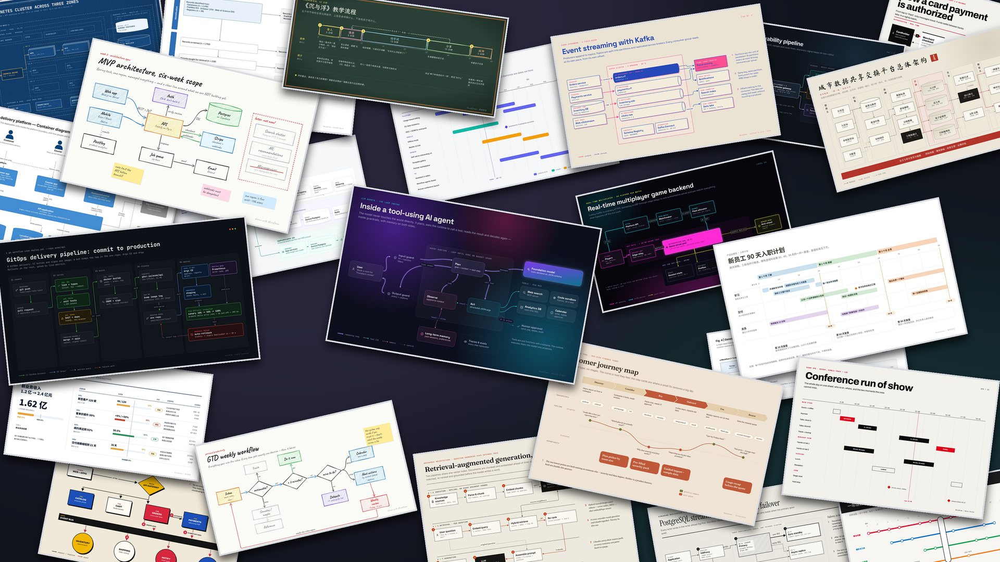

<div align="center">

<picture>
  <source media="(prefers-color-scheme: dark)" srcset="assets/brand/wordmark-dark.svg">
  
</picture>

<p><strong>Draw anything. Design with taste.</strong></p>
<p>让每个人，都能把想法表达得更好。</p>

<p>
  <a href="https://kanjieteam.github.io/MuseDraw/">看作品 ↗</a> ·
  <a href="#开始创作">开始创作</a> ·
  <a href="docs/usage.zh-CN.md">使用指南</a> ·
  <a href="README.en.md">English</a>
</p>

</div>

MuseDraw 是一个开源视觉创作项目，将设计方法与绘图工具带进你熟悉的 AI 智能体。用自己的语言描述想法，或提供资料与参考图，开始创作，再用对话继续修改。

[](https://kanjieteam.github.io/MuseDraw/)

## 为你的想法，找到合适的表达

你负责想表达什么，MuseDraw 帮你考虑怎么呈现：先看到什么，哪些内容放在一起，哪里需要强调，哪里应该留白。

- **从你的内容开始。** 几句话、一份资料、一张参考图，都可以成为起点。说明用途和想保留的内容即可。
- **让设计贴合内容。** 我们关注构图、文字、色彩与细节的配合，让作品有清楚的主次，也有自己的性格。
- **把修改留在对话里。** 补充一个步骤、调整一处重点，或沿着喜欢的方向继续打磨。
- **拿到作品，也保留修改的余地。** 当前图示工作流提供高清图片与可编辑文件，方便使用、分享和继续完善。

[浏览作品与源文件](https://kanjieteam.github.io/MuseDraw/) · [完整视觉案例库](https://kanjieteam.github.io/MuseDraw/collections/visual-cases/) · [了解当前使用方式](docs/usage.zh-CN.md)

## 开始创作

在支持 Skill、能读写文件并执行命令的 AI 智能体中安装：

```bash
npx skills add KanJieTeam/MuseDraw
```

安装后，直接描述需求。例如：

```text
用 MuseDraw 画清楚这段内容发布流程，给新同事看：
草稿 → 编辑审核 → 发布。
审核未通过时，退回草稿修改。突出主流程。
```

可以告诉它作品给谁看、用在哪里，以及喜欢的参考。无需填写坐标或颜色代码，也不必先挑模板。

首次使用需要 Node.js 22+、Playwright 与兼容浏览器。已有环境可复用，具体设置见[安装与快速出图](docs/fast-start.zh-CN.md)。下载不便时，可用[轻量 Skill 包](https://kanjieteam.github.io/MuseDraw/downloads/musedraw-skill.zip)。

## 继续改，直到适合你

看过第一版，接着说：

```text
把退回修改的路径画得更清楚，其他内容保持不变。
```

```text
颜色再克制一些，重点保留在主流程上。
```

图示默认交付 PNG，并保留场景源文件与 SVG。需要修改时，继续告诉智能体改哪里即可。

[查看修改与交付说明](docs/usage.zh-CN.md#继续修改与交付)

## 让好的设计，更容易获得

我们希望每个人都能清楚地解释事情、表达感受、分享想法。MuseDraw 的长期目标，是让专业的设计判断与制作能力成为人人可用的创作支持。

这需要持续研究不同的视觉语言，把值得借鉴的经验落实到实际作品，并在新的需求和反复修改中检验。我们重视作品是否准确、贴合意图、有辨识度，以及是否方便继续使用。

当前可直接使用的主流程是图示创作与编辑。更广的视觉创作能力正在研究与验证中，进展以可用的工作流和实际作品为准。

## 一起把作品做好

欢迎带着真实需求、作品与改进建议加入。你可以分享自己的创作、指出不理想的地方，或贡献设计经验与使用反馈。

[使用指南](docs/usage.zh-CN.md) · [参与共建](CONTRIBUTING.zh-CN.md) · [反馈与建议](https://github.com/KanJieTeam/MuseDraw/issues)

[Apache-2.0](LICENSE) · [第三方许可](NOTICE)
