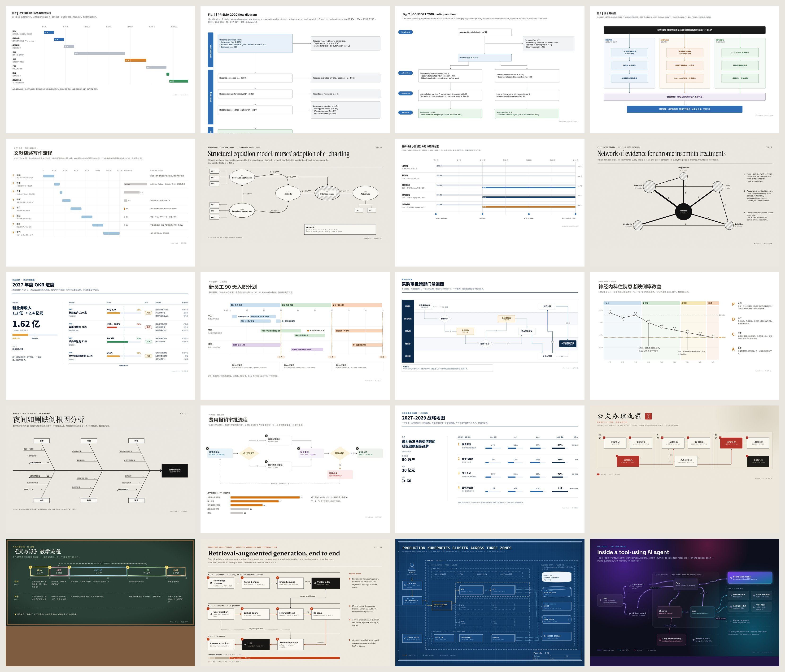

<div align="center">

<picture>
  <source media="(prefers-color-scheme: dark)" srcset="assets/brand/wordmark-dark.svg">
  
</picture>

<h3>给 AI 智能体的专业绘图 Skill</h3>

<p>一句话需求 → PNG 与原生可编辑 draw.io。20 套视觉风格，100 个办公与科研案例，场景可重渲染。</p>

<p>
  <a href="https://github.com/KanJieTeam/MuseDraw/actions/workflows/check.yml"></a>
  <a href="LICENSE"></a>
</p>

<p>
  <a href="#快速开始">快速开始</a> ·
  <a href="https://kanjieteam.github.io/MuseDraw/">在线图库 ↗</a> ·
  <a href="skills/musedraw/references/style-atlas.md">20 种风格</a> ·
  <a href="README.en.md">English</a>
</p>

</div>

[](https://kanjieteam.github.io/MuseDraw/)

<p align="center"><a href="https://kanjieteam.github.io/MuseDraw/"><strong>打开在线图库 → 选风格 · 看大图 · 复制提示词 · 下载 drawio</strong></a></p>

<p align="center"><sub>以上每张图都只来自一个 <code>scene.json</code>：基金技术路线、PRISMA、CONSORT、模型结构、结构方程、量表编制、OKR、跨部门泳道、PDCA、鱼骨图、公文流程、课堂设计、系统架构……</sub></p>

## 快速开始

```bash
npx skills add KanJieTeam/MuseDraw          # 安装 Skill 到你的智能体
npm --prefix skills/musedraw install        # 首次：安装开源字体与 Playwright（跨平台渲染一致）
```

然后在 Codex、Cursor 等能执行命令的智能体里说：

```text
用 MuseDraw 的「科研期刊」风格画国自然技术路线图：
科学问题是肝星状细胞代谢重编程如何驱动肝纤维化，三条研究内容是临床队列、细胞机制、动物验证，最后整合出机制与靶点。
```

智能体会选择版式、写出 `scene.json`、渲染、看图、修正，默认交付 `diagram@2x.png` 与原生可编辑的 `diagram.drawio`。`scene.json`、`diagram.svg` 与 `checks.json` 作为编辑来源、矢量辅助与检查记录保留。

PNG 保留纸张纹理、模糊与发光等视觉效果；draw.io 提供可编辑图形、文字与关联边，不承诺所有效果与 PNG 完全一致。

## 为科研与日常办公而做

| 科研 | 办公 | 教学 | 工程 |
| --- | --- | --- | --- |
| 技术路线图 · PRISMA · CONSORT · 模型结构 · 结构方程 · 量表编制 · 实验流程 · 课题甘特 · 中介/调节模型 | OKR 拆解 · 泳道审批 · PDCA · 鱼骨图 · 客户旅程 · 思维导图 · 公文流转 · RACI · 风险热力图 · 路线图 | 课堂五环节 · 课程地图 · 一日流程 | RAG · Kubernetes · 支付链路 · AI Agent · C4 · 可观测性 |

10 种布局块（树、思维导图、时间线、甘特、矩阵、漏斗、循环、鱼骨、泳道、表格）+ 时序图 + 自由图元。结构交给布局块，美感交给风格，事实留给你。

## 20 种风格，一行切换

`科研期刊` `纸墨编辑` `报刊黑白` `商务墨蓝` `水墨宣纸` `柔和笔记` `暖陶` `白板手绘` `黑板教学` `瑞士海报` `包豪斯` `地铁线路` `产品发布` `C4 标准` `工程蓝图` `终端暗色` `观测夜空` `极光玻璃` `孔版套印` `霓虹街机`

```bash
node skills/musedraw/scripts/musedraw.mjs render gallery/59-nsfc-roadmap-journal/scene.json --theme 水墨宣纸 --out output/ink
```

风格不是换色：每套风格有自己的字体、线条语法、质感、标注方式和版式。见 [风格图谱](skills/musedraw/references/style-atlas.md)。

## 复刻任何一个案例

每个案例目录都有 `scene.json`（完整来源）、`prompt.md`（一句话需求）、`diagram.drawio`、辅助 SVG 与 `preview.jpg`：

```bash
npm run gallery        # 重新渲染全部案例
```

打开[在线图库](https://kanjieteam.github.io/MuseDraw/)，选一种风格、点开喜欢的图，切换中文或 English 后复制提示词交给智能体；也可下载 drawio 直接编辑。[源文件索引](gallery/README.md) · [100 案例清单](gallery/catalog.json)

## 设计方法

- **一张图只证明一件事。** 先写副标题，再画图。
- **具体胜过“通用”。** 示例也用真实名词和能对上的数字，绝不出现“服务A / 模块甲”。
- **一个焦点，编号路径，旁注解释为什么。**
- **看图再交付。** `checks.json` 用真实字形检查溢出、碰撞和标签压框；[去 AI 味检查表](skills/musedraw/references/anti-ai-checklist.md) 负责审美。

## 参与共建

欢迎贡献新案例、新风格和新的布局块：复制一个 `gallery/` 目录，改内容，渲染，看图，提交 `scene.json` + `prompt.md`。提交前运行 `python scripts/check.py`。[贡献指南](CONTRIBUTING.zh-CN.md) · [提出问题](https://github.com/KanJieTeam/MuseDraw/issues)

## 限制

- 需要能读写文件、执行命令的智能体；纯聊天网页无法运行渲染。
- PNG 需要 Node.js 22+ 与 Chromium（`npm install` 自动安装）；无浏览器时可用 `--svg-only`。
- 不是统计绘图工具：柱状图、散点图请用 matplotlib / ggplot。
- 案例中的数字为说明用途；真实项目以你提供的事实为准。
- 旧版自动布局路线（`render_graph.mjs`）仍保留，见 [语义图说明](docs/semantic-graph.zh-CN.md)。

## 开源许可

[Apache-2.0](LICENSE) · 字体均为 SIL OFL 开源字体 · [品牌标识](assets/brand/README.md)
