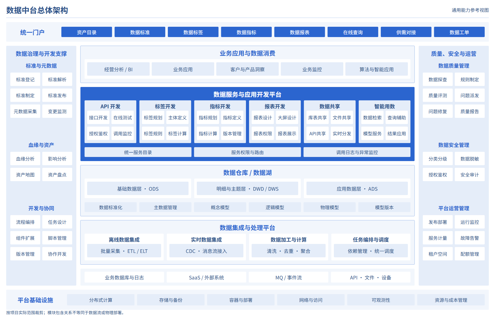
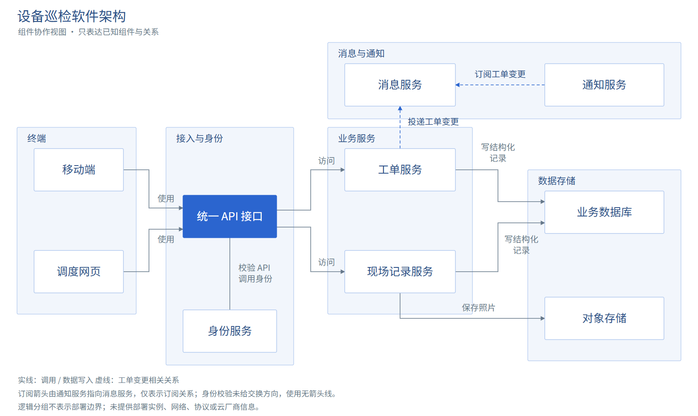

# MuseDraw

给你的 AI 智能体提供专业科研绘图能力，从软件架构图开始。

[English](README.md)



MuseDraw 为现有 AI 智能体提供设计指南、原创案例和配图工作流。它是自包含的 Skill，不是独立网页应用，也不是 MCP server。

## 一句话开始

向能够读取仓库文件、执行本地工具并保存输出的智能体提出：

```text
用 https://github.com/KanJieTeam/MuseDraw 画一张数据中台架构图。
包括数据来源、离线与实时接入、数据仓库/湖、数据服务和消费能力，
在两侧组织治理与运营支撑。标为通用参考，输出 PNG 和可编辑 SVG。
```

智能体应读取仓库根目录的 [SKILL.md](SKILL.md)，再完整加载 [skills/musedraw/SKILL.md](skills/musedraw/SKILL.md) 及任务相关资源。粘贴 URL 不等于自动安装 Skill，也不会让普通聊天网页自动获得文件和执行工具。完整流程见[使用指南](docs/usage.zh-CN.md)。

<details>
<summary>可选：通过 Skills CLI 安装</summary>

需要 Node.js 18+：

```bash
npx skills add KanJieTeam/MuseDraw
```

按交互提示选择智能体或客户端。安装注册 Skill，不会补齐宿主执行环境或 PNG 渲染依赖。

</details>

## 首版能做什么

- 能力架构：分层、能力分组和贯穿支撑。
- 组件与集成架构：组件、接口、交换关系和边界。
- 部署架构：依据已提供的实例、环境及网络边界资料绘制。

默认交付 PNG 和可编辑 SVG，使用原生文字与几何。内置 Python 渲染器只实现固定的数据中台能力骨架，不是通用架构自动布局引擎；其他视图依据具体需求设计原创 SVG。

科研流程和 Python/R 统计图是未来方向，首版尚未支持。组织架构和普通业务流程图也不在当前架构图范围内。

## 另一种视图：设备巡检软件



这张逻辑组件图包含 10 个节点、10 条关系，区分 API 接入、业务服务、存储和消息，不补部署实例或云厂商。

- 数据中台：[SVG](examples/data-platform/diagram.svg)、[需求说明](examples/data-platform/brief.md)、[检查记录](examples/data-platform/review.md)。
- 设备巡检：[SVG](examples/inspection-platform/diagram.svg)、[需求说明](examples/inspection-platform/brief.md)、[检查记录](examples/inspection-platform/review.md)。

以上是原创参考案例，不是真实客户系统证据，也不代表外部验收。

## 工具与后续修改

内置渲染器需要 Python 3.10+。PNG 预览与导出需要宿主已有 Node.js 22+、Playwright，以及 Chrome/Chromium 或兼容浏览器。智能体应检查实际环境，缺少依赖时如实说明。无需另装 CAD 引擎；MuseDraw 本身不额外要求模型 API key 或 MCP 服务。

可以继续让同一智能体调整分组、间距、字体或配色。只改视觉时，要求保持已提供的组件与关系不变；SVG 也可用于进一步编辑。

渲染方式、检查和依赖边界见[使用指南](docs/usage.zh-CN.md)。

## 参与贡献

欢迎设计改进、可复现案例及明确的缺陷报告。先读[贡献指南](CONTRIBUTING.zh-CN.md)，再运行仓库检查：

```bash
python scripts/check.py
```

程序检查不能替代实际看图，也不能证明架构语义正确。

## 许可证

[Apache-2.0](LICENSE)。仓库包含原创案例及其源文件，不转载社区参考模板。
