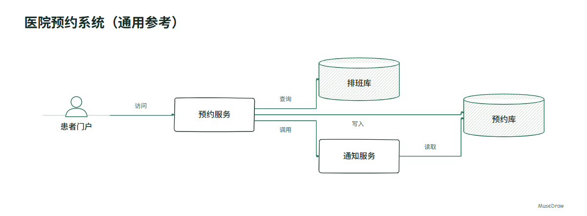
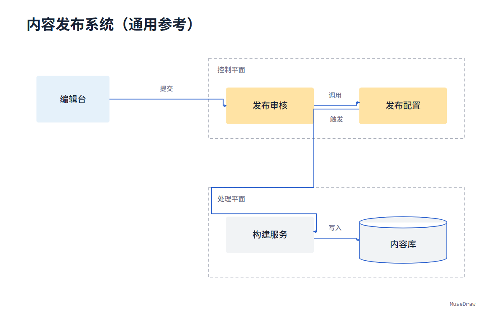

# MuseDraw 语义图工作流：真实模型验证

2026-10-14，`deepseek-flash` 调用安装版绘图工具，共 10 次响应。
两组“首次生成 + 三轮修改”8/8，两个新题材2/2，均首次通过。
没有向模型提供案例图片、SVG、坐标或预期答案；没有事后人工改图。

[实现与运行方法](../../semantic-graph.zh-CN.md) · [测试摘要](proof/summary.json) · [源码哈希](proof/source-hashes.json)

## 实际输出

| 主题 | 风格 | 初次生成 | 对话末状态 |
| --- | --- | --- | --- |
| 项目资料归档 | 手绘线稿 | [图与语义文档](examples/archive-sketch/round-0/document.json) | [三轮后](examples/archive-sketch/round-3/document.json) |
| 设备数据平台 | 终端色域 | [图与语义文档](examples/device-planes/round-0/document.json) | [三轮后](examples/device-planes/round-3/document.json) |
| 医院预约 | 手绘线稿 | [新题材](examples/appointment-holdout/round-0/document.json) | — |
| 内容发布 | 终端色域 | [新题材](examples/publishing-holdout/round-0/document.json) | — |

每个目录保存用户短需求、原生 SVG、完整 PNG、1200px 预览、语义文档、检查摘要。
修改轮还保存模型实际返回的 `edits.json`，不是重新生成一张示意图。

## 检查什么

核对节点清单、方向、显式归属、未修改节点及关系身份，实际渲染后的文字边界、遮挡和连线穿字。
独立审查发现的归属框误包和方向评分遗漏已补反例，并重新调用模型。
测试工具及安装版源码哈希冻结在摘要中；本次证据不需要密钥才能阅读。
完整请求、响应和失败记录保留于本地，不随公开包携带私人运行配置。

这不是十轮编辑基准、跨模型比较或设计师审美验收。
这里只测试两种构图与两种风格；不承诺任意智能体、任意拓扑均能运行。
语义文档可重渲染；同版源码与字体下测试的 SVG 字节一致，PNG 抗锯齿仍可有微小差异。
早期模型直接手写 SVG 的两题均失败，未计入本次成功，也未覆盖原失败记录。
