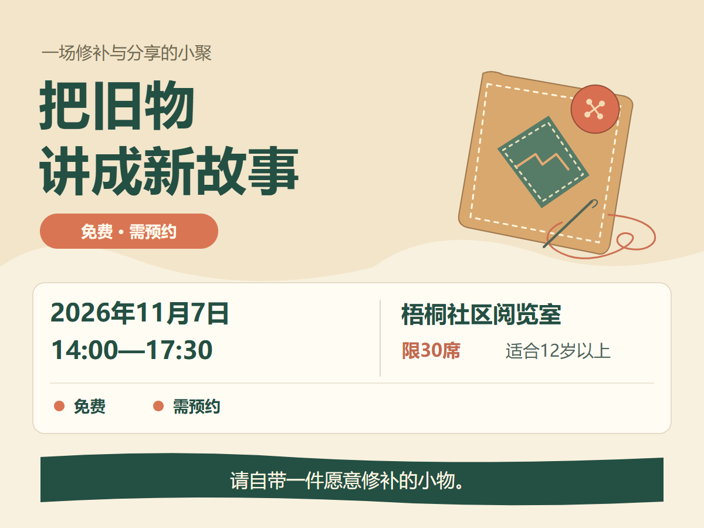

# 判断与限制

两幅来自六题探索性对照，均为新制作的原生SVG，没有嵌入第三方图片。研究条件不是经过人工择优后的“最佳设计”。

研究条件将免费、预约、席位、年龄与自带物品集中在同一绿色区域，时间地点保持独立。该关系对应“是否能参加”的判断。三个匿名模型评审在条件组织上给出了较一致的优势判断；这不能代替真实用户的查找时间或参与理解测试。

比较图也有可取处：主标题明确，时间地点清楚。其参与条件分在不同区域，免费与预约重复出现；研究图则重复了活动题名。不能把全部差异都解释成改进。

可迁移决定：共同影响同一次行动的条件可集中组织；时间地点仍要好找。条件很多时先处理分组与换行，不把所有文字统一缩小。不照搬本图的纸色、绿色横带或针线插画。

两幅1200×900 PNG已实际逐张查看，文字与给定事实核对；本次贡献保留原始图像哈希，以确认没有在评审后修图。浏览器成图不是人类可用性验证，两幅静态例图也不是MuseDraw场景引擎新增的海报工作流。

原始对照的冻结Skill不同于本次缩编模块，不能把该对照当作本次模块的独立效果证明。后续应使用新题和真实产品流程继续验证。
