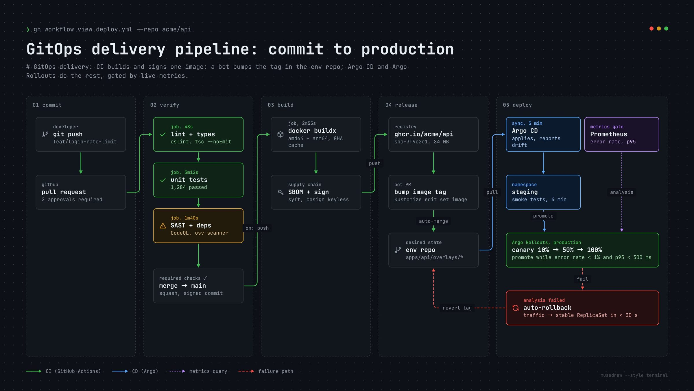

# GitOps delivery pipeline: commit to production

| | |
| --- | --- |
| 类别 Category | 工程 · engineering |
| 风格 Style | 终端暗色 · Terminal (`terminal`) |
| 状态 Status | 预览 · preview |
| 结构 Blocks | primitives |



## 一句话需求 · One-line prompt

> Use MuseDraw in the Terminal style to draw: GitOps delivery pipeline: commit to production. GitOps delivery: CI builds and signs one image; a bot bumps the tag in the env repo; Argo CD and Argo Rollouts do the rest, gated by live metrics.

把这句话交给任何能读写文件、执行命令的智能体（Codex、Cursor 等），并让它使用 MuseDraw skill。
Give this sentence to any agent that can run commands, with the MuseDraw skill installed.

## 复刻 · Reproduce

```sh
node skills/musedraw/scripts/musedraw.mjs render gallery/03-gitops-terminal/scene.json
node skills/musedraw/scripts/musedraw.mjs render gallery/03-gitops-terminal/scene.json --theme journal --out output/restyle
```

`scene.json` 是这张图的完整、可编辑来源；示例中的人名、机构与数字为说明用途。
`scene.json` is the complete editable source; names and numbers in examples are illustrative.
