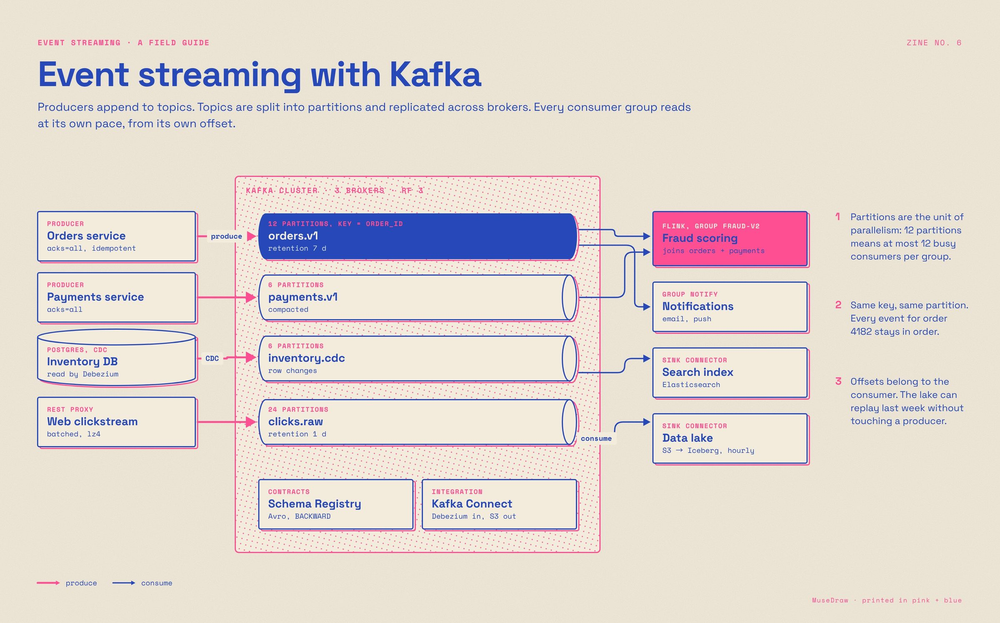

# Event streaming with Kafka

| | |
| --- | --- |
| 类别 Category | 工程 · engineering |
| 风格 Style | 孔版套印 · Riso Print (`riso`) |
| 状态 Status | 预览 · preview |
| 结构 Blocks | primitives |



## 一句话需求 · One-line prompt

> Use MuseDraw in the Riso Print style to draw: Event streaming with Kafka. Producers append to topics. Topics are split into partitions and replicated across brokers. Every consumer group reads at its own pace, from its own offset.

把这句话交给任何能读写文件、执行命令的智能体（Codex、Cursor 等），并让它使用 MuseDraw skill。
Give this sentence to any agent that can run commands, with the MuseDraw skill installed.

## 复刻 · Reproduce

```sh
node skills/musedraw/scripts/musedraw.mjs render gallery/06-kafka-riso/scene.json
node skills/musedraw/scripts/musedraw.mjs render gallery/06-kafka-riso/scene.json --theme journal --out output/restyle
```

`scene.json` 是这张图的完整、可编辑来源；示例中的人名、机构与数字为说明用途。
`scene.json` is the complete editable source; names and numbers in examples are illustrative.
