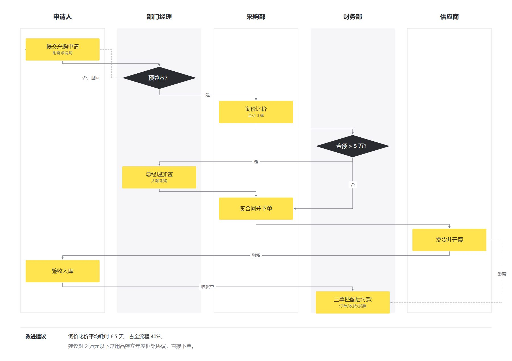

# 采购审批跨部门泳道图：纵向审批

| | |
| --- | --- |
| 类别 Category | 办公 · office |
| 风格 Style | 商务墨蓝 · Enterprise Navy (`enterprise`) |
| 状态 Status | 已审图 · reviewed |



## 一句话需求 · One-line prompt

> 用 MuseDraw 的「商务墨蓝」风格画纵向采购审批泳道图：申请人、部门经理、采购部、财务部和供应商各占一列，流程从上向下推进。黄色表示操作，黑色菱形表示判断，保留预算退回、大额加签和付款凭证分支。

## 复刻 · Reproduce

```sh
node skills/musedraw/scripts/musedraw.mjs render gallery/101-procurement-vertical-enterprise/scene.json
```

`scene.json` 保存内容、布局与本例的配色及模块样式。默认交付 PNG，并保留 SVG 与场景 JSON。
示例中的数字与机构设定用于说明；按自己的事实替换内容即可。图面默认不显示页眉、图号或署名。

The scene preserves content, layout and this case's local visual tokens. Its default exports are PNG, SVG and scene JSON. Example values are illustrative.
