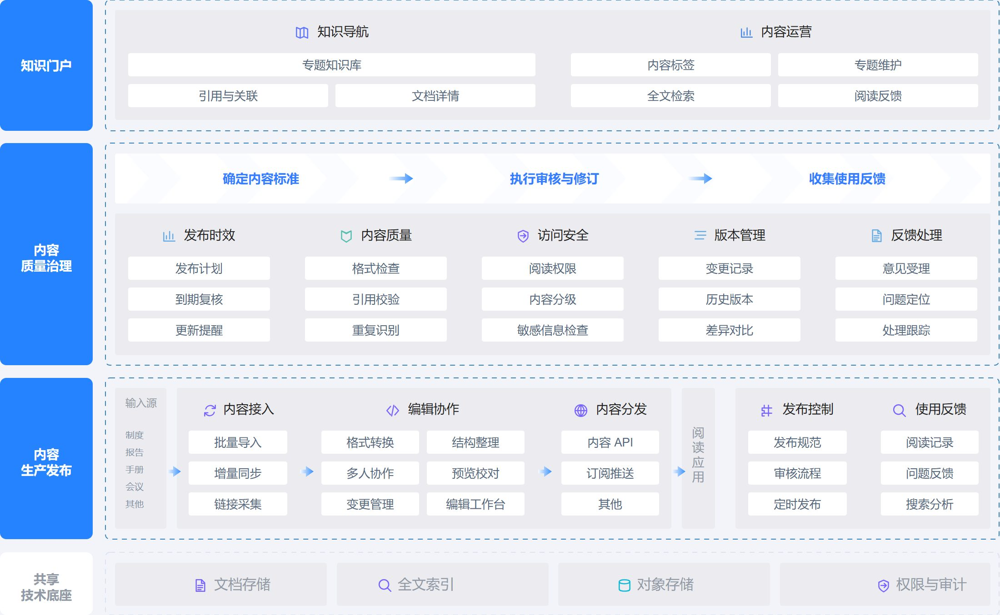

# 企业知识与内容平台



## 中文需求

> 用 MuseDraw 参考图库「企业知识与内容平台」的明蓝灰底样式，画企业知识平台：包括知识门户、内容质量与权限治理、内容接入、编辑协作、分发发布、使用反馈，以及存储和检索底座。保留分层全景和紧凑模块的表达，不加厂商标识和页脚。

## English brief

Use MuseDraw with the bright-blue and gray layered composition of the Enterprise Knowledge and Content Platform gallery example. Include a knowledge portal, content quality and access governance, ingestion, editing, distribution, publishing, feedback, storage and search. Keep compact capability groups without vendor logos or footers.

## 下载与复用

[SVG](diagram.svg) · [完整场景](scene.json)

原样生成本例：

```sh
node skills/musedraw/scripts/musedraw.mjs render gallery/102-knowledge-platform-enterprise/scene.json
```

本例保存已审定的原生矢量排版；改内容时可编辑场景内的 nativeSvg。文字与图形可独立编辑，本例连线是矢量路径，不会随节点自动重连。短需求用于表达设计方向；原样复刻请渲染场景文件，不依赖模型猜坐标。

This art-directed vector scene preserves the approved composition. Edit nativeSvg shapes/text for revisions. Connectors are editable vector paths, not node-attached edges. Render the scene for exact replay; the short brief communicates design intent. Named-theme switching applies to graph scenes, not this fixed artwork.

## 设计参考

[DataLeap 文档产品架构](https://docs.volcengine.com/docs/BigDataResearchandDevelopmentGovernanceSuite/IntroductiontoDataLeap?lang=zh)。本例替换了内容，去除了厂商标识与页脚；参考资料的权利归原权利人，不表示背书或取得其素材的再许可。
