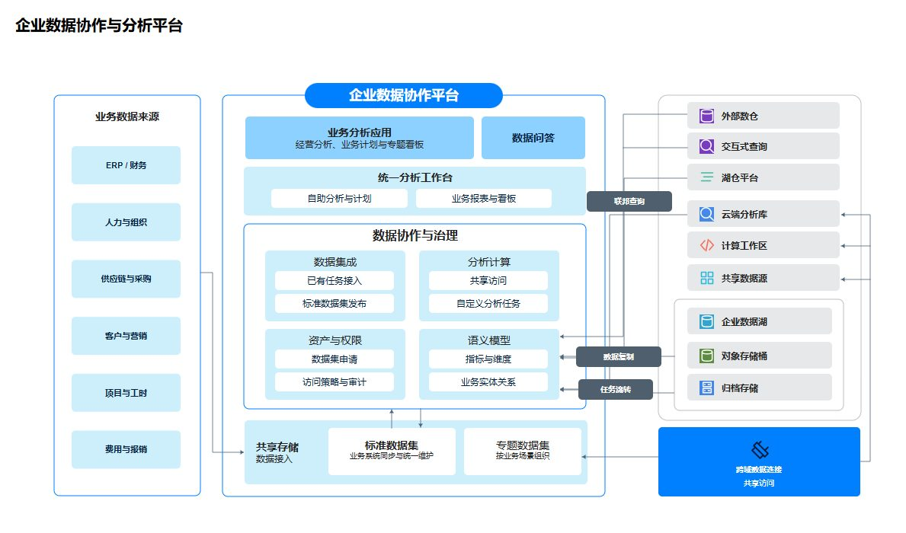

# 企业数据协作与分析平台



## 中文需求

> 用 MuseDraw 参考图库「企业数据协作与分析平台」的浅蓝集成样式画数据平台：左边是财务、人力、供应链等业务来源，中间是分析应用、统一工作台、数据集成、计算和语义模型，右边是外部数仓、查询、湖仓与对象存储。保留清晰边界与图中的连接，不加厂商标识和页脚。

## English brief

Use MuseDraw with the pale-blue integration composition of the Enterprise Data Collaboration and Analytics Platform gallery example. Put finance, HR and supply-chain sources on the left; analytics applications, a shared workbench, ingestion, compute and semantic models in the center; external warehouses, query engines, lakehouses and object storage on the right. Keep explicit boundaries and the shown connections without vendor logos or footers.

## 下载与复用

[SVG](diagram.svg) · [完整场景](scene.json)

原样生成本例：

```sh
node skills/musedraw/scripts/musedraw.mjs render gallery/103-data-collaboration-enterprise/scene.json
```

本例保存已审定的原生矢量排版；改内容时可编辑场景内的 nativeSvg。文字与图形可独立编辑，本例连线是矢量路径，不会随节点自动重连。短需求用于表达设计方向；原样复刻请渲染场景文件，不依赖模型猜坐标。

This art-directed vector scene preserves the approved composition. Edit nativeSvg shapes/text for revisions. Connectors are editable vector paths, not node-attached edges. Render the scene for exact replay; the short brief communicates design intent. Named-theme switching applies to graph scenes, not this fixed artwork.

## 设计参考

[Explore your Hyperscaler data with SAP Business Data Cloud · image of solution diagram](https://architecture.learning.sap.com/docs/ref-arch/b27373)。本例替换了内容，去除了厂商标识与页脚；参考资料的权利归原权利人，不表示背书或取得其素材的再许可。
