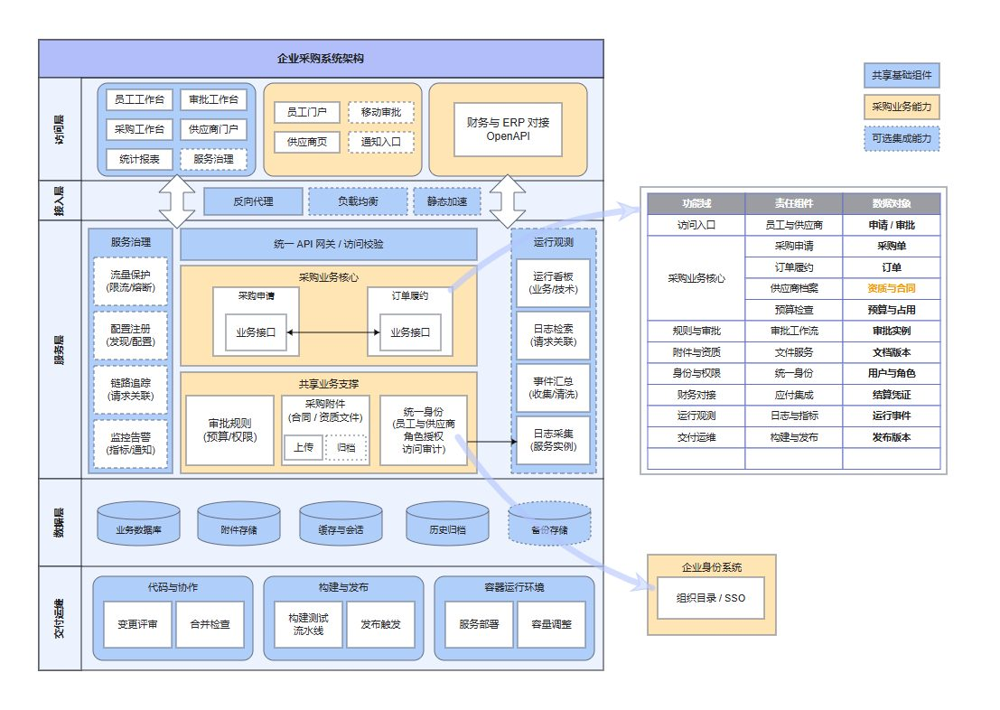

# 企业采购系统架构



## 中文需求

> 用 MuseDraw 参考图库「企业采购系统架构」的粉蓝杏黄样式画采购系统：员工和供应商入口、统一网关、采购申请、订单履约、审批规则、附件与资质、身份权限、财务对接、数据存储和交付运维。按访问、接入、服务、数据和运维分层，右边放功能责任清单，不加厂商标识和页脚。

## English brief

Use MuseDraw with the pink-blue and apricot composition of the Enterprise Procurement System gallery example. Include employee and supplier portals, an API gateway, purchase requests, order fulfillment, approval rules, qualification documents, identity, finance integration, storage and delivery operations. Use access, gateway, service, data and operations layers with a responsibility table on the right, without vendor logos or footers.

## 下载与复用

[可编辑 draw.io](diagram.drawio) · [SVG](diagram.svg) · [完整场景](scene.json)

原样生成本例：

```sh
node skills/musedraw/scripts/musedraw.mjs render gallery/104-procurement-services-enterprise/scene.json
```

本例保存已审定的原生矢量排版；改内容时可编辑 draw.io 或场景内的 nativeSvg。文字与图形可独立编辑，本例连线是矢量路径，不会随节点自动重连。短需求用于表达设计方向；原样复刻请渲染场景文件，不依赖模型猜坐标。

This art-directed vector scene preserves the approved composition. Edit the draw.io shapes/text or nativeSvg for revisions. Connectors are editable vector paths, not node-attached edges. Render the scene for exact replay; the short brief communicates design intent. Named-theme switching applies to graph scenes, not this fixed artwork.

## 设计参考

[微服务架构图](https://www.edrawmax.cn/templates/file/1028245/)。本例替换了内容，去除了厂商标识与页脚；参考资料的权利归原权利人，不表示背书或取得其素材的再许可。
