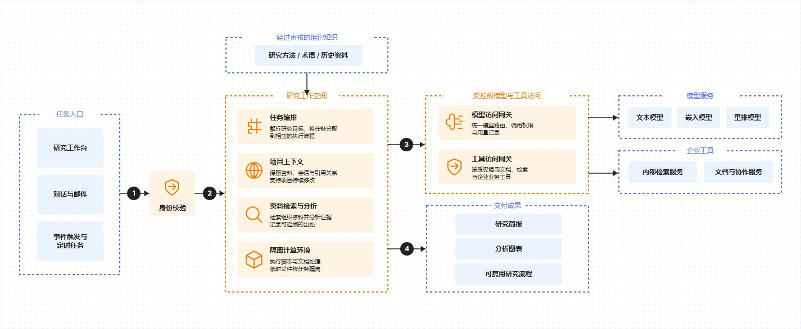

# 企业研究与知识工作台



## 中文需求

> 用 MuseDraw 参考图库「企业研究与知识工作台」的白底橙蓝样式画企业研究工作台：任务入口和组织知识在左侧，身份校验后进入任务编排、项目上下文、资料检索分析和隔离计算环境，再通过模型与工具网关连接企业工具，输出研究简报、图表和可复用流程。不加厂商标识和页脚。

## English brief

Use MuseDraw with the white, orange and blue workspace composition of the Enterprise Research and Knowledge Workspace gallery example. Place task inputs and organizational knowledge on the left, followed by identity checks, orchestration, project context, retrieval and analysis, isolated computation, model and tool gateways, enterprise tools and outputs: research briefs, charts and reusable workflows. Omit vendor logos and footers.

## 下载与复用

[SVG](diagram.svg) · [完整场景](scene.json)

原样生成本例：

```sh
node skills/musedraw/scripts/musedraw.mjs render gallery/105-research-workspace-product/scene.json
```

本例保存已审定的原生矢量排版；改内容时可编辑场景内的 nativeSvg。文字与图形可独立编辑，本例连线是矢量路径，不会随节点自动重连。短需求用于表达设计方向；原样复刻请渲染场景文件，不依赖模型猜坐标。

This art-directed vector scene preserves the approved composition. Edit nativeSvg shapes/text for revisions. Connectors are editable vector paths, not node-attached edges. Render the scene for exact replay; the short brief communicates design intent. Named-theme switching applies to graph scenes, not this fixed artwork.

## 设计参考

[企业 AI 工作区：执行、依赖与成果](https://developers.cloudflare.com/reference-architecture/diagrams/ai/enterprise-ai-agent-workspace/)。本例替换了内容，去除了厂商标识与页脚；参考资料的权利归原权利人，不表示背书或取得其素材的再许可。
