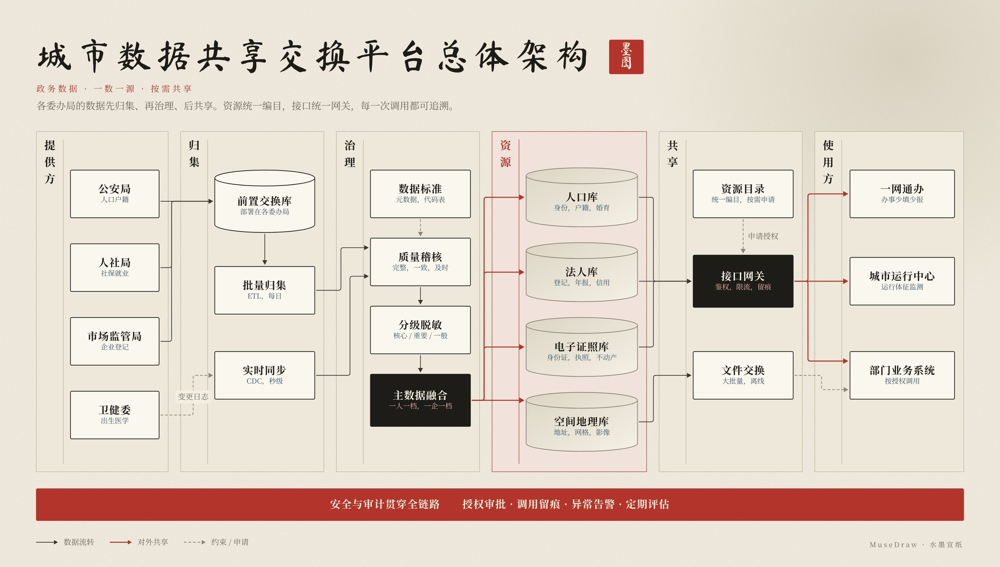

# 城市数据共享交换平台总体架构

| | |
| --- | --- |
| 类别 Category | 工程 · engineering |
| 风格 Style | 水墨宣纸 · Ink Wash (`ink-wash`) |
| 状态 Status | 已审图 · reviewed |
| 结构 Blocks | primitives |



## 一句话需求 · One-line prompt

> 用 MuseDraw 的「水墨宣纸」风格画一张图：城市数据共享交换平台总体架构。各委办局的数据先归集、再治理、后共享。资源统一编目，接口统一网关，每一次调用都可追溯。

把这句话交给任何能读写文件、执行命令的智能体（Codex、Cursor 等），并让它使用 MuseDraw skill。
Give this sentence to any agent that can run commands, with the MuseDraw skill installed.

## 复刻 · Reproduce

```sh
node skills/musedraw/scripts/musedraw.mjs render gallery/11-data-exchange-ink-wash/scene.json
node skills/musedraw/scripts/musedraw.mjs render gallery/11-data-exchange-ink-wash/scene.json --theme journal --out output/restyle
```

`scene.json` 是这张图的完整、可编辑来源；示例中的人名、机构与数字为说明用途。
`scene.json` is the complete editable source; names and numbers in examples are illustrative.
