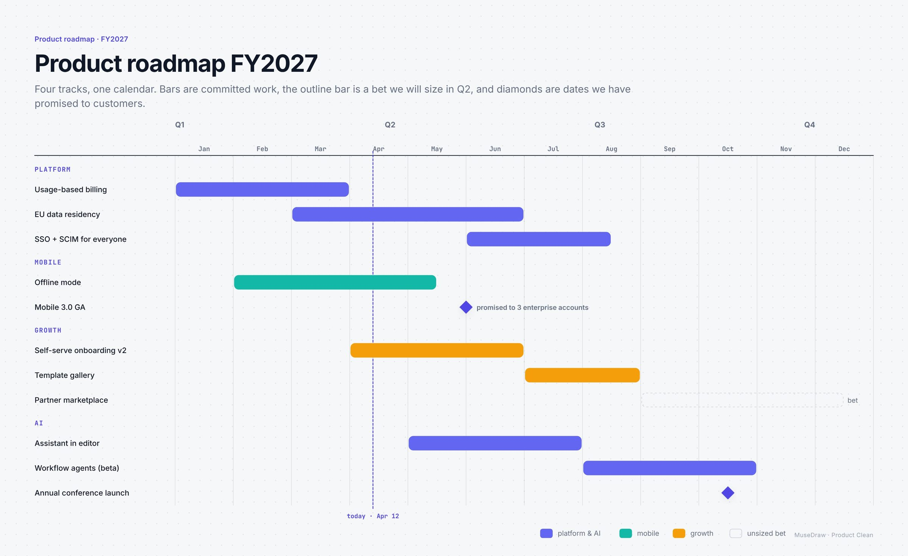

# Product roadmap FY2027

| | |
| --- | --- |
| 类别 Category | 办公 · office |
| 风格 Style | 产品发布 · Product Clean (`product`) |
| 状态 Status | 预览 · preview |
| 结构 Blocks | gantt |



## 一句话需求 · One-line prompt

> Use MuseDraw in the Product Clean style to draw: Product roadmap FY2027. Four tracks, one calendar. Bars are committed work, the outline bar is a bet we will size in Q2, and diamonds are dates we have promised to customers.

把这句话交给任何能读写文件、执行命令的智能体（Codex、Cursor 等），并让它使用 MuseDraw skill。
Give this sentence to any agent that can run commands, with the MuseDraw skill installed.

## 复刻 · Reproduce

```sh
node skills/musedraw/scripts/musedraw.mjs render gallery/19-product-roadmap-product/scene.json
node skills/musedraw/scripts/musedraw.mjs render gallery/19-product-roadmap-product/scene.json --theme journal --out output/restyle
```

`scene.json` 是这张图的完整、可编辑来源；示例中的人名、机构与数字为说明用途。
`scene.json` is the complete editable source; names and numbers in examples are illustrative.
