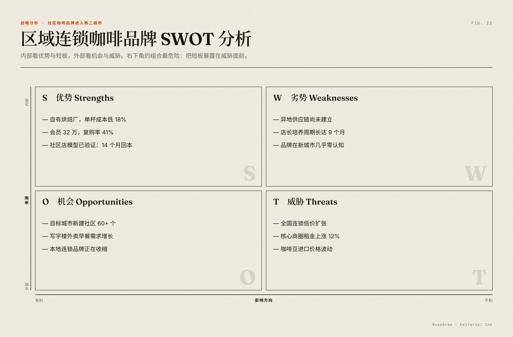

# 区域连锁咖啡品牌 SWOT 分析

| | |
| --- | --- |
| 类别 Category | 办公 · office |
| 风格 Style | 纸墨编辑 · Editorial Ink (`editorial`) |
| 状态 Status | 预览 · preview |
| 结构 Blocks | matrix |



## 一句话需求 · One-line prompt

> 用 MuseDraw 的「纸墨编辑」风格画一张图：区域连锁咖啡品牌 SWOT 分析。内部看优势与短板，外部看机会与威胁。右下角的组合最危险：把短板暴露在威胁面前。

把这句话交给任何能读写文件、执行命令的智能体（Codex、Cursor 等），并让它使用 MuseDraw skill。
Give this sentence to any agent that can run commands, with the MuseDraw skill installed.

## 复刻 · Reproduce

```sh
node skills/musedraw/scripts/musedraw.mjs render gallery/22-swot-editorial/scene.json
node skills/musedraw/scripts/musedraw.mjs render gallery/22-swot-editorial/scene.json --theme journal --out output/restyle
```

`scene.json` 是这张图的完整、可编辑来源；示例中的人名、机构与数字为说明用途。
`scene.json` is the complete editable source; names and numbers in examples are illustrative.
