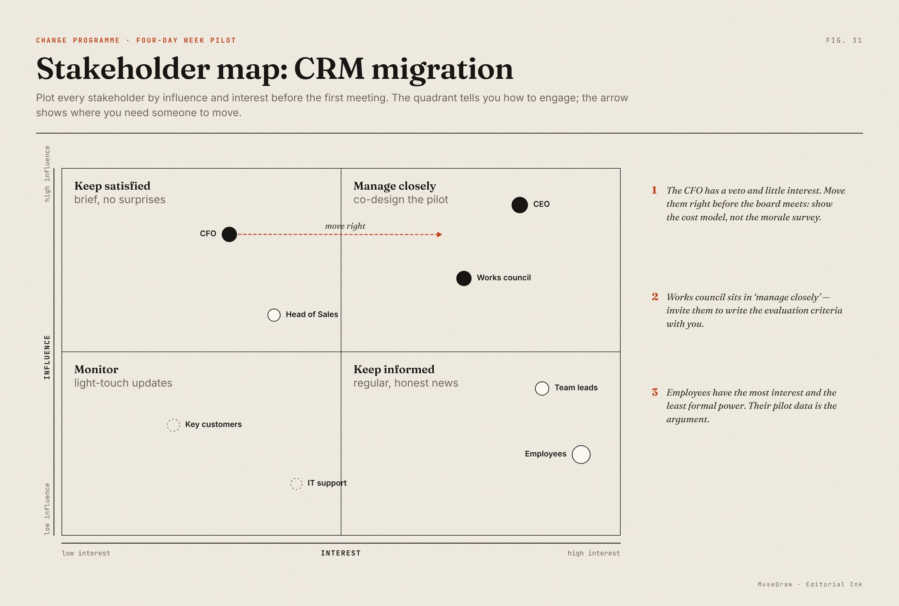

# Stakeholder map: CRM migration

| | |
| --- | --- |
| 类别 Category | 办公 · office |
| 风格 Style | 纸墨编辑 · Editorial Ink (`editorial`) |
| 状态 Status | 预览 · preview |
| 结构 Blocks | matrix |



## 一句话需求 · One-line prompt

> Use MuseDraw in the Editorial Ink style to draw: Stakeholder map: CRM migration. Plot every stakeholder by influence and interest before the first meeting. The quadrant tells you how to engage; the arrow shows where you need someone to move.

把这句话交给任何能读写文件、执行命令的智能体（Codex、Cursor 等），并让它使用 MuseDraw skill。
Give this sentence to any agent that can run commands, with the MuseDraw skill installed.

## 复刻 · Reproduce

```sh
node skills/musedraw/scripts/musedraw.mjs render gallery/31-stakeholder-map-editorial/scene.json
node skills/musedraw/scripts/musedraw.mjs render gallery/31-stakeholder-map-editorial/scene.json --theme journal --out output/restyle
```

`scene.json` 是这张图的完整、可编辑来源；示例中的人名、机构与数字为说明用途。
`scene.json` is the complete editable source; names and numbers in examples are illustrative.
