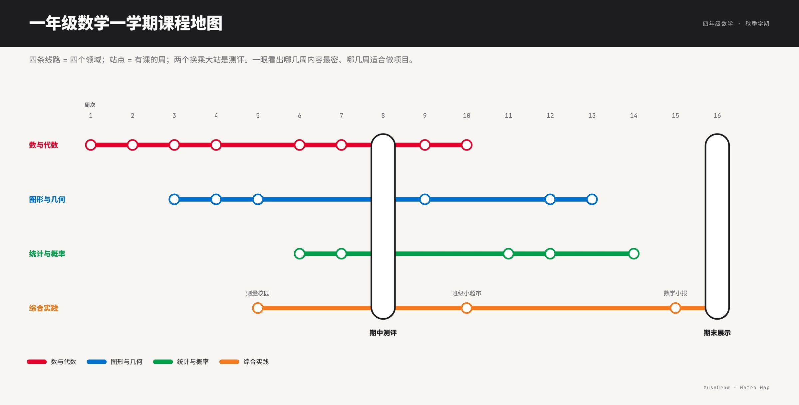

# 一年级数学一学期课程地图

| | |
| --- | --- |
| 类别 Category | 教学 · teaching |
| 风格 Style | 地铁线路 · Metro Map (`metro`) |
| 状态 Status | 预览 · preview |
| 结构 Blocks | primitives |



## 一句话需求 · One-line prompt

> 用 MuseDraw 的「地铁线路」风格画一张图：一年级数学一学期课程地图。四条线路 = 四个领域；站点 = 有课的周；两个换乘大站是测评。一眼看出哪几周内容最密、哪几周适合做项目。

把这句话交给任何能读写文件、执行命令的智能体（Codex、Cursor 等），并让它使用 MuseDraw skill。
Give this sentence to any agent that can run commands, with the MuseDraw skill installed.

## 复刻 · Reproduce

```sh
node skills/musedraw/scripts/musedraw.mjs render gallery/39-curriculum-map-metro/scene.json
node skills/musedraw/scripts/musedraw.mjs render gallery/39-curriculum-map-metro/scene.json --theme journal --out output/restyle
```

`scene.json` 是这张图的完整、可编辑来源；示例中的人名、机构与数字为说明用途。
`scene.json` is the complete editable source; names and numbers in examples are illustrative.
