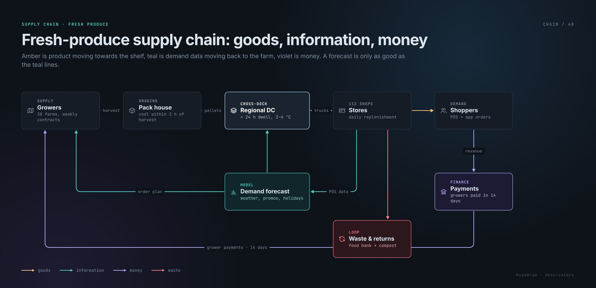

# Fresh-produce supply chain: goods, information, money

| | |
| --- | --- |
| 类别 Category | 办公 · office |
| 风格 Style | 观测夜空 · Observatory (`observatory`) |
| 状态 Status | 预览 · preview |
| 结构 Blocks | primitives |



## 一句话需求 · One-line prompt

> Use MuseDraw in the Observatory style to draw: Fresh-produce supply chain: goods, information, money. Amber is product moving towards the shelf, teal is demand data moving back to the farm, violet is money. A forecast is only as good as the teal lines.

把这句话交给任何能读写文件、执行命令的智能体（Codex、Cursor 等），并让它使用 MuseDraw skill。
Give this sentence to any agent that can run commands, with the MuseDraw skill installed.

## 复刻 · Reproduce

```sh
node skills/musedraw/scripts/musedraw.mjs render gallery/48-supply-chain-observatory/scene.json
node skills/musedraw/scripts/musedraw.mjs render gallery/48-supply-chain-observatory/scene.json --theme journal --out output/restyle
```

`scene.json` 是这张图的完整、可编辑来源；示例中的人名、机构与数字为说明用途。
`scene.json` is the complete editable source; names and numbers in examples are illustrative.
