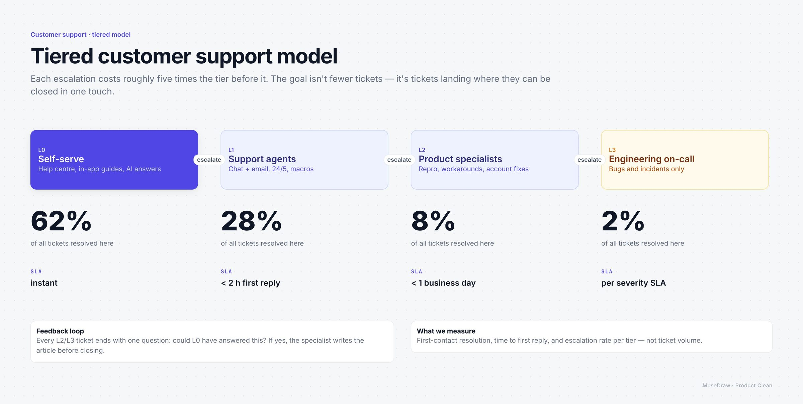

# Tiered customer support model

| | |
| --- | --- |
| 类别 Category | 办公 · office |
| 风格 Style | 产品发布 · Product Clean (`product`) |
| 状态 Status | 预览 · preview |
| 结构 Blocks | primitives |



## 一句话需求 · One-line prompt

> Use MuseDraw in the Product Clean style to draw: Tiered customer support model. Each escalation costs roughly five times the tier before it. The goal isn't fewer tickets — it's tickets landing where they can be closed in one touch.

把这句话交给任何能读写文件、执行命令的智能体（Codex、Cursor 等），并让它使用 MuseDraw skill。
Give this sentence to any agent that can run commands, with the MuseDraw skill installed.

## 复刻 · Reproduce

```sh
node skills/musedraw/scripts/musedraw.mjs render gallery/51-support-tiers-product/scene.json
node skills/musedraw/scripts/musedraw.mjs render gallery/51-support-tiers-product/scene.json --theme journal --out output/restyle
```

`scene.json` 是这张图的完整、可编辑来源；示例中的人名、机构与数字为说明用途。
`scene.json` is the complete editable source; names and numbers in examples are illustrative.
