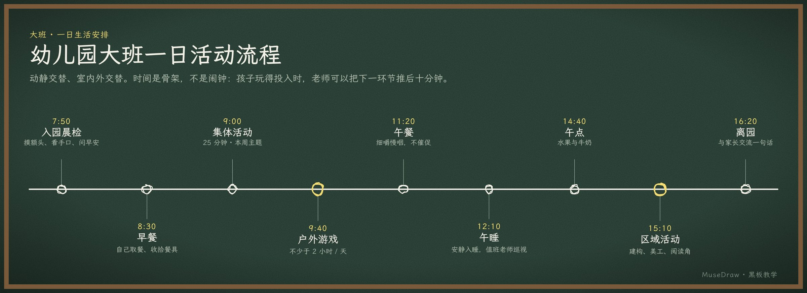

# 幼儿园大班一日活动流程

| | |
| --- | --- |
| 类别 Category | 教学 · teaching |
| 风格 Style | 黑板教学 · Chalkboard (`chalkboard`) |
| 状态 Status | 预览 · preview |
| 结构 Blocks | timeline |



## 一句话需求 · One-line prompt

> 用 MuseDraw 的「黑板教学」风格画一张图：幼儿园大班一日活动流程。动静交替、室内外交替。时间是骨架，不是闹钟：孩子玩得投入时，老师可以把下一环节推后十分钟。

把这句话交给任何能读写文件、执行命令的智能体（Codex、Cursor 等），并让它使用 MuseDraw skill。
Give this sentence to any agent that can run commands, with the MuseDraw skill installed.

## 复刻 · Reproduce

```sh
node skills/musedraw/scripts/musedraw.mjs render gallery/53-kindergarten-day-chalkboard/scene.json
node skills/musedraw/scripts/musedraw.mjs render gallery/53-kindergarten-day-chalkboard/scene.json --theme journal --out output/restyle
```

`scene.json` 是这张图的完整、可编辑来源；示例中的人名、机构与数字为说明用途。
`scene.json` is the complete editable source; names and numbers in examples are illustrative.
