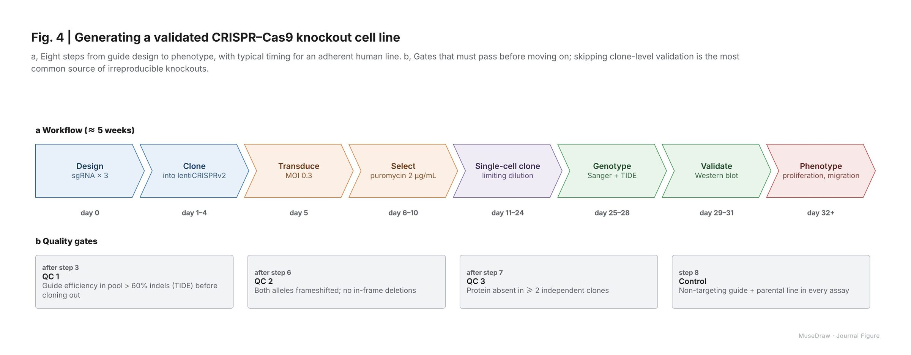

# Fig. 4 | Generating a validated CRISPR–Cas9 knockout cell line

| | |
| --- | --- |
| 类别 Category | 科研 · research |
| 风格 Style | 科研期刊 · Journal Figure (`journal`) |
| 状态 Status | 预览 · preview |
| 结构 Blocks | primitives |



## 一句话需求 · One-line prompt

> Use MuseDraw in the Journal Figure style to draw: Fig. 4 | Generating a validated CRISPR–Cas9 knockout cell line. a, Eight steps from guide design to phenotype, with typical timing for an adherent human line. b, Gates that must pass before moving on; skipping clone-level validation is the most common source of irreproducible knockouts.

把这句话交给任何能读写文件、执行命令的智能体（Codex、Cursor 等），并让它使用 MuseDraw skill。
Give this sentence to any agent that can run commands, with the MuseDraw skill installed.

## 复刻 · Reproduce

```sh
node skills/musedraw/scripts/musedraw.mjs render gallery/62-crispr-workflow-journal/scene.json
node skills/musedraw/scripts/musedraw.mjs render gallery/62-crispr-workflow-journal/scene.json --theme journal --out output/restyle
```

`scene.json` 是这张图的完整、可编辑来源；示例中的人名、机构与数字为说明用途。
`scene.json` is the complete editable source; names and numbers in examples are illustrative.
