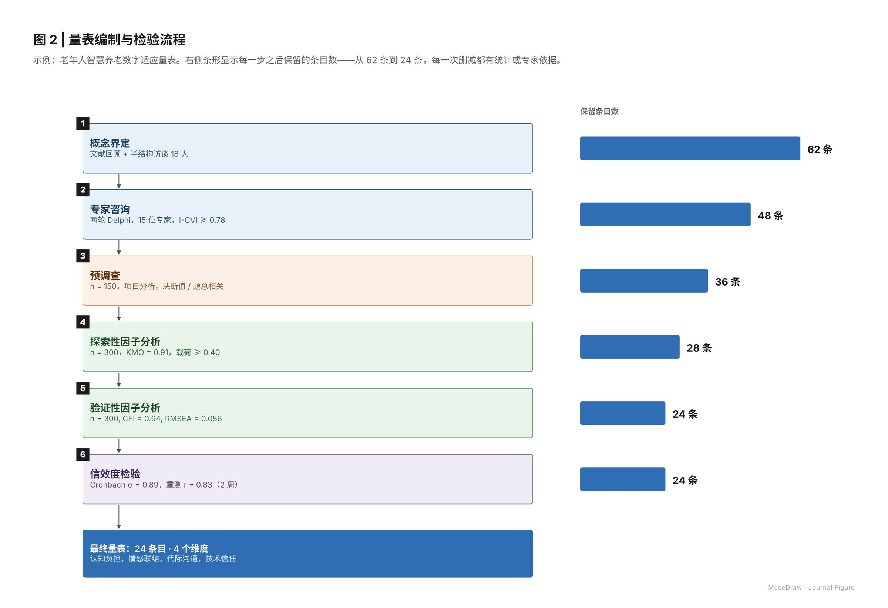

# 图 2 | 量表编制与检验流程

| | |
| --- | --- |
| 类别 Category | 科研 · research |
| 风格 Style | 科研期刊 · Journal Figure (`journal`) |
| 状态 Status | 预览 · preview |
| 结构 Blocks | primitives |



## 一句话需求 · One-line prompt

> 用 MuseDraw 的「科研期刊」风格画一张图：图 2 | 量表编制与检验流程。示例：老年人智慧养老数字适应量表。右侧条形显示每一步之后保留的条目数——从 62 条到 24 条，每一次删减都有统计或专家依据。

把这句话交给任何能读写文件、执行命令的智能体（Codex、Cursor 等），并让它使用 MuseDraw skill。
Give this sentence to any agent that can run commands, with the MuseDraw skill installed.

## 复刻 · Reproduce

```sh
node skills/musedraw/scripts/musedraw.mjs render gallery/69-scale-development-journal/scene.json
node skills/musedraw/scripts/musedraw.mjs render gallery/69-scale-development-journal/scene.json --theme journal --out output/restyle
```

`scene.json` 是这张图的完整、可编辑来源；示例中的人名、机构与数字为说明用途。
`scene.json` is the complete editable source; names and numbers in examples are illustrative.
