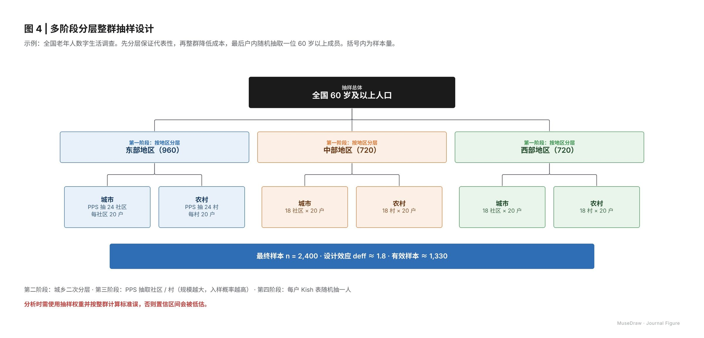

# 图 4 | 多阶段分层整群抽样设计

| | |
| --- | --- |
| 类别 Category | 科研 · research |
| 风格 Style | 科研期刊 · Journal Figure (`journal`) |
| 状态 Status | 预览 · preview |
| 结构 Blocks | tree |



## 一句话需求 · One-line prompt

> 用 MuseDraw 的「科研期刊」风格画一张图：图 4 | 多阶段分层整群抽样设计。示例：全国老年人数字生活调查。先分层保证代表性，再整群降低成本，最后户内随机抽取一位 60 岁以上成员。括号内为样本量。

把这句话交给任何能读写文件、执行命令的智能体（Codex、Cursor 等），并让它使用 MuseDraw skill。
Give this sentence to any agent that can run commands, with the MuseDraw skill installed.

## 复刻 · Reproduce

```sh
node skills/musedraw/scripts/musedraw.mjs render gallery/74-stratified-sampling-journal/scene.json
node skills/musedraw/scripts/musedraw.mjs render gallery/74-stratified-sampling-journal/scene.json --theme journal --out output/restyle
```

`scene.json` 是这张图的完整、可编辑来源；示例中的人名、机构与数字为说明用途。
`scene.json` is the complete editable source; names and numbers in examples are illustrative.
