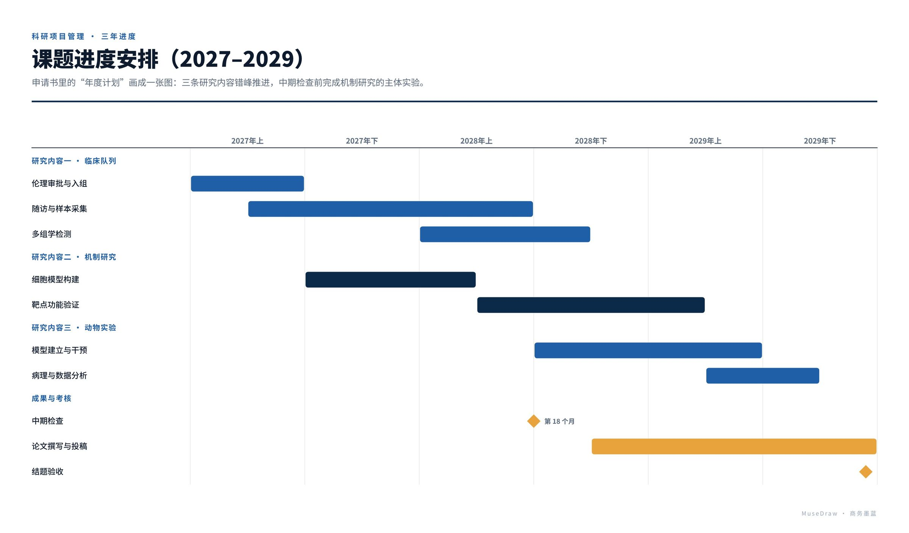

# 课题进度安排（2027–2029）

| | |
| --- | --- |
| 类别 Category | 科研 · research |
| 风格 Style | 商务墨蓝 · Enterprise Navy (`enterprise`) |
| 状态 Status | 预览 · preview |
| 结构 Blocks | gantt |



## 一句话需求 · One-line prompt

> 用 MuseDraw 的「商务墨蓝」风格画一张图：课题进度安排（2027–2029）。申请书里的“年度计划”画成一张图：三条研究内容错峰推进，中期检查前完成机制研究的主体实验。

把这句话交给任何能读写文件、执行命令的智能体（Codex、Cursor 等），并让它使用 MuseDraw skill。
Give this sentence to any agent that can run commands, with the MuseDraw skill installed.

## 复刻 · Reproduce

```sh
node skills/musedraw/scripts/musedraw.mjs render gallery/77-grant-timeline-enterprise/scene.json
node skills/musedraw/scripts/musedraw.mjs render gallery/77-grant-timeline-enterprise/scene.json --theme journal --out output/restyle
```

`scene.json` 是这张图的完整、可编辑来源；示例中的人名、机构与数字为说明用途。
`scene.json` is the complete editable source; names and numbers in examples are illustrative.
