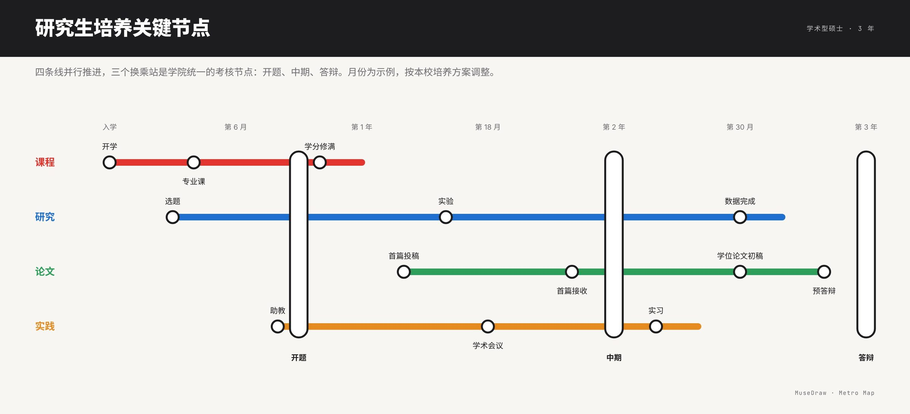

# 研究生培养关键节点

| | |
| --- | --- |
| 类别 Category | 科研 · research |
| 风格 Style | 地铁线路 · Metro Map (`metro`) |
| 状态 Status | 已审图 · reviewed |
| 结构 Blocks | primitives |



## 一句话需求 · One-line prompt

> 用 MuseDraw 的「地铁线路」风格画一张图：研究生培养关键节点。四条线并行推进，三个换乘站是学院统一的考核节点：开题、中期、答辩。月份为示例，按本校培养方案调整。

把这句话交给任何能读写文件、执行命令的智能体（Codex、Cursor 等），并让它使用 MuseDraw skill。
Give this sentence to any agent that can run commands, with the MuseDraw skill installed.

## 复刻 · Reproduce

```sh
node skills/musedraw/scripts/musedraw.mjs render gallery/83-graduate-milestones-metro/scene.json
node skills/musedraw/scripts/musedraw.mjs render gallery/83-graduate-milestones-metro/scene.json --theme journal --out output/restyle
```

`scene.json` 是这张图的完整、可编辑来源；示例中的人名、机构与数字为说明用途。
`scene.json` is the complete editable source; names and numbers in examples are illustrative.
