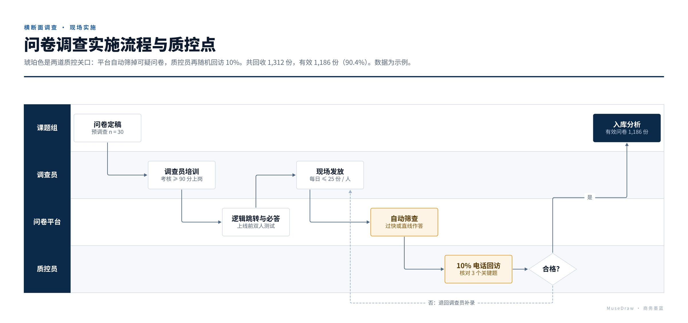

# 问卷调查实施流程与质控点

| | |
| --- | --- |
| 类别 Category | 科研 · research |
| 风格 Style | 商务墨蓝 · Enterprise Navy (`enterprise`) |
| 状态 Status | 已审图 · reviewed |
| 结构 Blocks | swimlane |



## 一句话需求 · One-line prompt

> 用 MuseDraw 的「商务墨蓝」风格画一张图：问卷调查实施流程与质控点。琥珀色是两道质控关口：平台自动筛掉可疑问卷，质控员再随机回访 10%。共回收 1,312 份，有效 1,186 份（90.4%）。数据为示例。

把这句话交给任何能读写文件、执行命令的智能体（Codex、Cursor 等），并让它使用 MuseDraw skill。
Give this sentence to any agent that can run commands, with the MuseDraw skill installed.

## 复刻 · Reproduce

```sh
node skills/musedraw/scripts/musedraw.mjs render gallery/85-survey-qc-enterprise/scene.json
node skills/musedraw/scripts/musedraw.mjs render gallery/85-survey-qc-enterprise/scene.json --theme journal --out output/restyle
```

`scene.json` 是这张图的完整、可编辑来源；示例中的人名、机构与数字为说明用途。
`scene.json` is the complete editable source; names and numbers in examples are illustrative.
