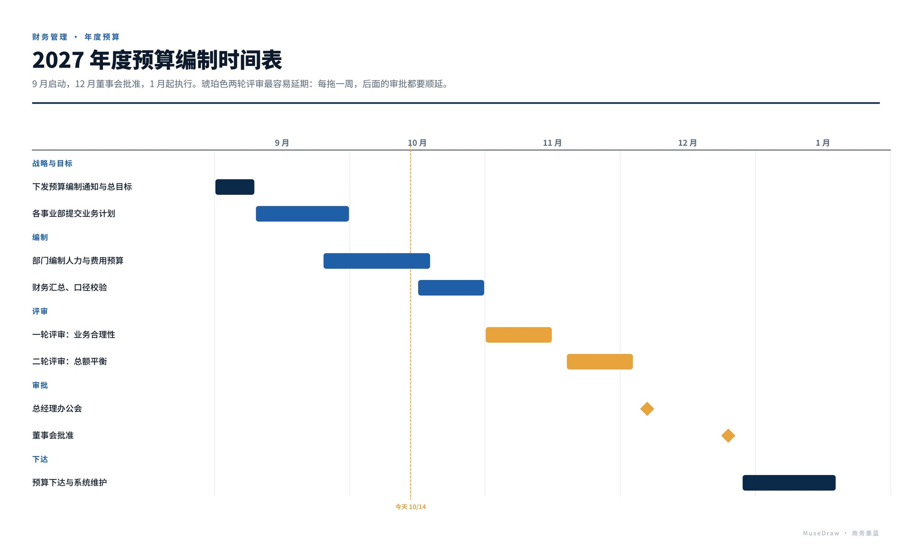

# 2027 年度预算编制时间表

| | |
| --- | --- |
| 类别 Category | 办公 · office |
| 风格 Style | 商务墨蓝 · Enterprise Navy (`enterprise`) |
| 状态 Status | 已审图 · reviewed |
| 结构 Blocks | gantt |



## 一句话需求 · One-line prompt

> 用 MuseDraw 的「商务墨蓝」风格画一张图：2027 年度预算编制时间表。9 月启动，12 月董事会批准，1 月起执行。琥珀色两轮评审最容易延期：每拖一周，后面的审批都要顺延。

把这句话交给任何能读写文件、执行命令的智能体（Codex、Cursor 等），并让它使用 MuseDraw skill。
Give this sentence to any agent that can run commands, with the MuseDraw skill installed.

## 复刻 · Reproduce

```sh
node skills/musedraw/scripts/musedraw.mjs render gallery/92-budget-cycle-enterprise/scene.json
node skills/musedraw/scripts/musedraw.mjs render gallery/92-budget-cycle-enterprise/scene.json --theme journal --out output/restyle
```

`scene.json` 是这张图的完整、可编辑来源；示例中的人名、机构与数字为说明用途。
`scene.json` is the complete editable source; names and numbers in examples are illustrative.
