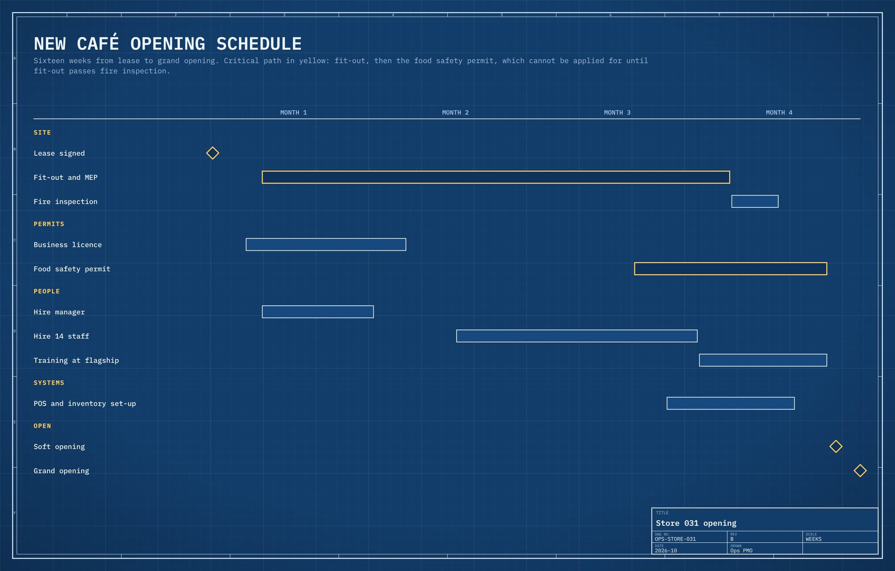

# New café opening schedule

| | |
| --- | --- |
| 类别 Category | 办公 · office |
| 风格 Style | 工程蓝图 · Blueprint (`blueprint`) |
| 状态 Status | 已审图 · reviewed |
| 结构 Blocks | gantt |



## 一句话需求 · One-line prompt

> Use MuseDraw in the Blueprint style to draw: New café opening schedule. Sixteen weeks from lease to grand opening. Critical path in yellow: fit-out, then the food safety permit, which cannot be applied for until fit-out passes fire inspection.

把这句话交给任何能读写文件、执行命令的智能体（Codex、Cursor 等），并让它使用 MuseDraw skill。
Give this sentence to any agent that can run commands, with the MuseDraw skill installed.

## 复刻 · Reproduce

```sh
node skills/musedraw/scripts/musedraw.mjs render gallery/96-store-opening-blueprint/scene.json
node skills/musedraw/scripts/musedraw.mjs render gallery/96-store-opening-blueprint/scene.json --theme journal --out output/restyle
```

`scene.json` 是这张图的完整、可编辑来源；示例中的人名、机构与数字为说明用途。
`scene.json` is the complete editable source; names and numbers in examples are illustrative.
