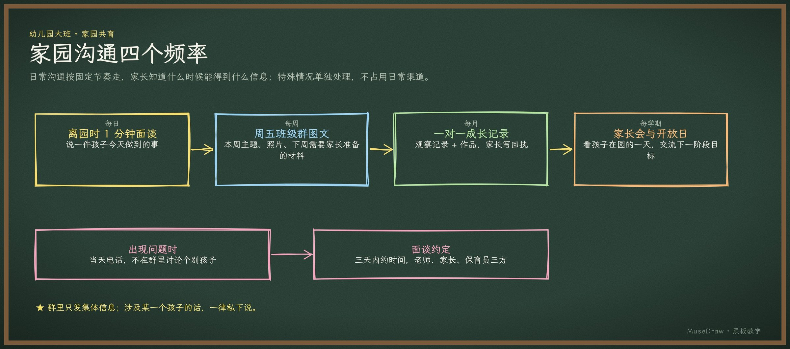

# 家园沟通四个频率

| | |
| --- | --- |
| 类别 Category | 教学 · teaching |
| 风格 Style | 黑板教学 · Chalkboard (`chalkboard`) |
| 状态 Status | 已审图 · reviewed |
| 结构 Blocks | primitives |



## 一句话需求 · One-line prompt

> 用 MuseDraw 的「黑板教学」风格画一张图：家园沟通四个频率。日常沟通按固定节奏走，家长知道什么时候能得到什么信息；特殊情况单独处理，不占用日常渠道。

把这句话交给任何能读写文件、执行命令的智能体（Codex、Cursor 等），并让它使用 MuseDraw skill。
Give this sentence to any agent that can run commands, with the MuseDraw skill installed.

## 复刻 · Reproduce

```sh
node skills/musedraw/scripts/musedraw.mjs render gallery/99-home-school-chalkboard/scene.json
node skills/musedraw/scripts/musedraw.mjs render gallery/99-home-school-chalkboard/scene.json --theme journal --out output/restyle
```

`scene.json` 是这张图的完整、可编辑来源；示例中的人名、机构与数字为说明用途。
`scene.json` is the complete editable source; names and numbers in examples are illustrative.
